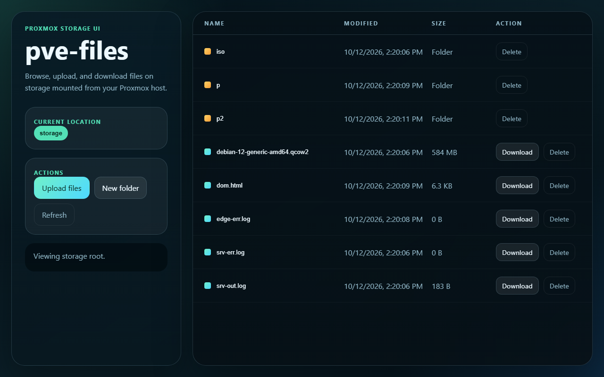
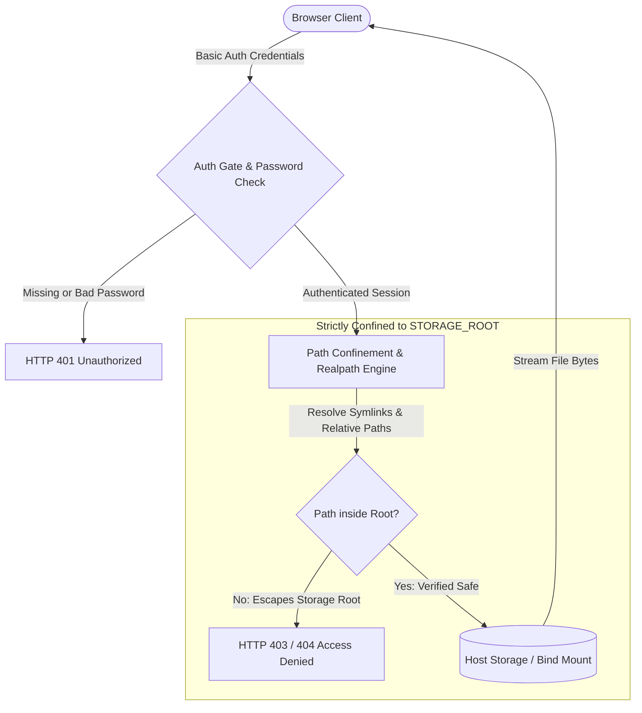

<p align="center"><a href="https://kitsunetechnologies.org/work"></a></p>

# PVE File Desk (pve-files)

> Secure, zero-dependency web file manager tailored for Proxmox VE host storage, bind-mounts, and homelab servers. Hardened path traversal prevention, authenticated endpoints, and streaming upload/download.

<p align="center">
  <a href="https://github.com/KitsuneTech1/pve-files/releases"></a>
  <a href="https://github.com/KitsuneTech1/pve-files/actions/workflows/ci.yml"></a>
  <a href="LICENSE"></a>
  <a href="https://nodejs.org"></a>
  <a href="package.json"></a>
  <a href="server.js"></a>
</p>

<p align="center">
  <a href="https://github.com/KitsuneTech1/pve-files/releases/latest"><strong>📦 Download Latest Release ZIP</strong></a> •
  <a href="#-quick-start-noob-friendly"><strong>⚡ Quick Start Guide</strong></a> •
  <a href="#-proxmox--lxc-homelab-deployment"><strong>🖥️ Proxmox Deployment</strong></a>
</p>

---



## Architecture & Confinement Model



---

## Features

- **Zero Dependencies**: Built strictly using Node.js core libraries. Zero `node_modules` attack surface, no supply-chain risks.
- **Strict Path Confinement**: Every requested file path is verified via realpath/readlink against `STORAGE_ROOT`. Symlink escapes and `../` traversal attempts are rejected at the edge.
- **Fail-Closed Authentication**: Server refuses to boot unless a password (`PVE_FILES_PASSWORD`) is configured.
- **Mid-Stream Quota Protection**: Upload file size limits are enforced mid-stream; oversized payloads are aborted immediately without leaving temporary orphans on disk.
- **Recursive Directory Protection**: Recursive directory deletion requires explicit confirmation flags to prevent accidental root deletions.

---

## 🚀 Quick Start (Noob-Friendly)

### Option 1: One-Click Launch (Windows / Mac / Linux)
1. Download the [**Latest Release ZIP**](https://github.com/KitsuneTech1/pve-files/releases/latest) and extract it.
2. Double-click **`start.bat`** (Windows) or execute `./start.sh` (macOS/Linux).
3. The app starts on `http://localhost:3000` with sample storage and opens in your default browser.
4. Log in using username **`admin`** and password from `.env` (default: `changeme`).

---

## 🖥️ Proxmox & LXC Homelab Deployment

Run PVE File Desk in an unprivileged or privileged LXC container with a bind-mount to your ZFS pool or storage directory:

```bash
# 1. Clone into container
git clone https://github.com/KitsuneTech1/pve-files.git /opt/pve-files
cd /opt/pve-files

# 2. Configure systemd service
cat << 'EOF' > /etc/systemd/system/pve-files.service
[Unit]
Description=PVE File Desk
After=network.target

[Service]
Type=simple
User=root
WorkingDirectory=/opt/pve-files
Environment=PORT=3000
Environment=STORAGE_ROOT=/mnt/storage
Environment=PVE_FILES_USER=admin
Environment=PVE_FILES_PASSWORD=YourSecurePasswordHere
ExecStart=/usr/bin/node server.js
Restart=always

[Install]
WantedBy=multi-user.target
EOF

# 3. Enable and start service
systemctl daemon-reload
systemctl enable --now pve-files
```

---

## 🧪 Testing & Verification

Run the automated offline test suite:

```bash
npm test
```

Tests cover:
- Compulsory password enforcement on startup.
- Full API round-trips (create directory, stream upload, download, delete).
- Traversal payloads, symlink escape attempts, and host header tampering.
- Mid-stream 413 payload truncation without orphan leftovers.

---

## 🔒 Security Specifications

- **Zero NPM Dependencies**: Eliminates supply chain poisoning risk.
- **Defensive IO**: Rejects null-byte injections, directory rename collisions, and unconfined symlinks.
- **HTTP Security Headers**: Emits strict `X-Content-Type-Options: nosniff` headers on all responses.

---

## License

MIT. Copyright (c) 2026 Kitsune Technologies LLC. Full text in [LICENSE](LICENSE).

<p align="center"><sub>Part of <b>Buildtober 2026</b>: 31 open source projects in 31 days. Built by <a href="https://kitsunetechnologies.org/work">Kitsune Technologies</a>. More at <a href="https://github.com/KitsuneTech1">github.com/KitsuneTech1</a>.</sub></p>
