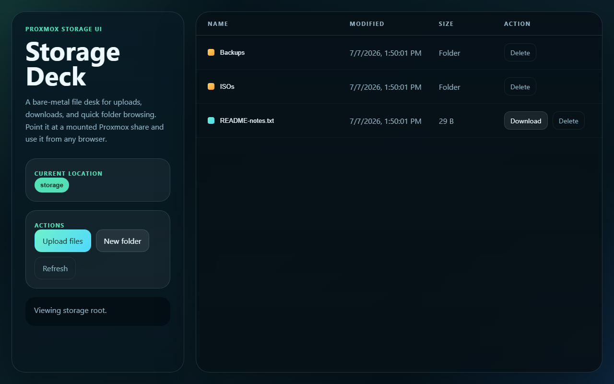

# pve-files

A small Node.js web UI for browsing, uploading, and downloading files on a storage path mounted from your Proxmox host.




## Features

- Browse folders under a configured storage root
- Upload files directly into the current folder
- Download files with a direct link
- Create folders
- Delete files or folders
- Path-traversal protection, all paths are resolved and checked against the storage root
- Upload size limit, configurable, rejects oversized uploads mid-stream

## Quick start

```bash
npm install
node server.js
```

Then open `http://localhost:3000`.

No dependencies are required to run the server itself, it uses only Node's built-in `http` and `fs` modules.

## Using it with Proxmox storage

This app expects the Proxmox-backed storage to already be mounted into the machine or container running it. It does not talk to the Proxmox API, it just reads and writes files at `STORAGE_ROOT`.

Examples:

- SMB share mounted to `Z:\proxmox-share` on Windows
- NFS share mounted to `/mnt/proxmox-storage` in a Linux VM or container
- A bind-mounted directory from a Proxmox LXC mount point

Set `STORAGE_ROOT` to that mounted path before starting the server.

Windows example:

```powershell
$env:STORAGE_ROOT='Z:\proxmox-share'
node server.js
```

Linux example:

```bash
STORAGE_ROOT=/mnt/proxmox-storage node server.js
```

## Config

Set these as environment variables, or copy `.env.example` to `.env` and load it with your process manager of choice.

| Variable | Default | Description |
|---|---|---|
| `PORT` | `3000` | Port the HTTP server listens on |
| `STORAGE_ROOT` | `./storage` | Root directory the UI browses, uploads to, and downloads from |
| `MAX_UPLOAD_BYTES` | `1073741824` (1 GB) | Maximum size for a single upload, larger uploads are rejected |

## Next improvements

- Login and authentication
- Drag-and-drop upload progress
- Chunked uploads for very large files
- File previews
- Share links with expiration

## License

MIT, see [LICENSE](LICENSE).

---
Built by [Kitsune Technologies](https://kitsunetechnologies.org). See more of our work at [kitsunetechnologies.org/work](https://kitsunetechnologies.org/work). Issues and PRs welcome.
